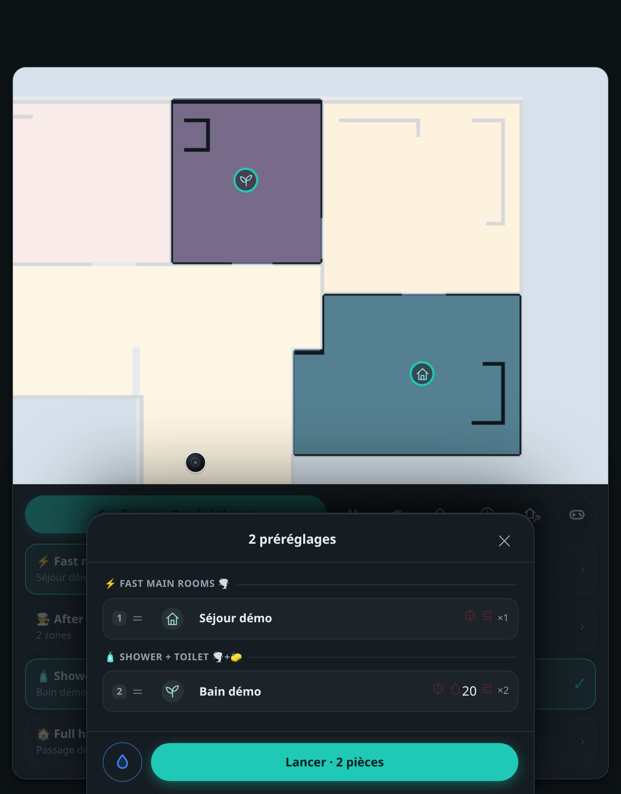
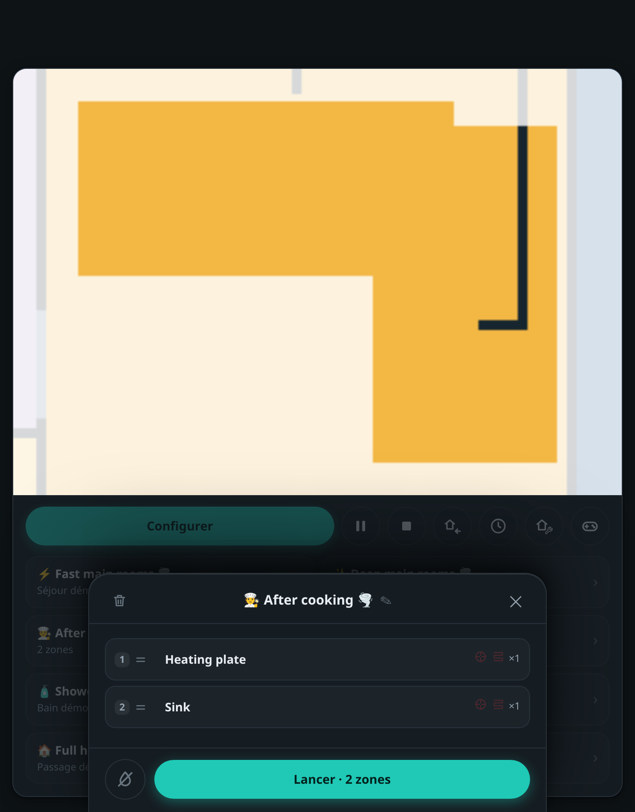

# Roborock personal panel

## Demo video (audio recommended) 

<div align="center">
  <video src="https://github.com/user-attachments/assets/a98cf020-d807-425d-bf62-200c7f63547a" controls></video>
</div>


> Yes, the music comes from the vacuum speakers.


A little web frontend for my vacuum, built on [local_roborock_server](https://github.com/Python-roborock/local_roborock_server) and [python-roborock](https://github.com/Python-roborock/python-roborock). Mostly French, made around my Saros 10R.

**This is for me. I’m sharing it as-is; I don’t plan to actively maintain it, provide support, or chase compatibility with other robots.** It is an unofficial project, not affiliated with Roborock.

## Why I use it alongside the official app

These are the workflows I wanted in my own interface, rather than a claim that every version of the official app lacks them:

- **Combine presets:** select several and run them together.
- **Zone presets:** save named rectangles and their cleaning settings.
- **Queue the next job:** add a preset or rooms while the current job finishes.
- **Revisit a clean:** replay its route and review the obstacles and photos it encountered, when available.
- **Remote view and routes:** camera, manual driving, tap-to-go, saved routes with observation pauses.
- **Chorégraphies, for fun:** timed moves and audio cues, with a virtual preview.

I still use the official app for the setup and device-specific features this does not cover. This panel assumes your robot already works with a local server. Camera, photos, and some settings depend on the robot and firmware.

## A look around

My preset names, shown with fictional rooms and a fictional floor plan.

<table>
  <tr>
    <th width="50%">Combine presets</th>
    <th width="50%">Zone presets</th>
  </tr>
  <tr>
    <td></td>
    <td></td>
  </tr>
</table>

## Run it

Requires Docker Compose and an already configured [local Roborock server](https://github.com/Python-roborock/local_roborock_server). The image fetches a pinned upstream Python client and applies the small patch in this repository; neither upstream project is forked or vendored here.

```sh
cp .env.example .env
# Set RR_BASE_URL, RR_EMAIL and RR_PIN for your local server.
docker compose up -d --build
```

Open <http://127.0.0.1:8099>. `RR_BASE_URL` must be reachable from the container. The example uses Docker’s host gateway; use your server’s actual address instead if it runs elsewhere. Rebuild after changing the source. State, presets, routes, and audio live in the `panel-data` volume.

There is no built-in login: the port binds to loopback by default. Use an authenticated HTTPS reverse proxy if you expose it elsewhere. Browser microphone/audio features need HTTPS or localhost.

## Upstream patches

- [Python client patch](patches/python-roborock/0001-panel-client-support.patch): water levels/status, history command, obstacle-photo fragments and timeouts, optional direct MQTT configuration.
- [Optional local-server patch](patches/local-roborock-server/0001-optional-cloudflare-turn.patch): Cloudflare TURN for remote video. **Not required** with upstream’s standard provided/external TURN relay.

[Patch versions, application commands, and camera setup](patches/README.md) · [Development and synthetic screenshots](docs/development.md)

The public package uses generic vector icons and no personal room-ID overrides. It contains no robot credentials, real maps, obstacle photos, audio files, or private Git history.
